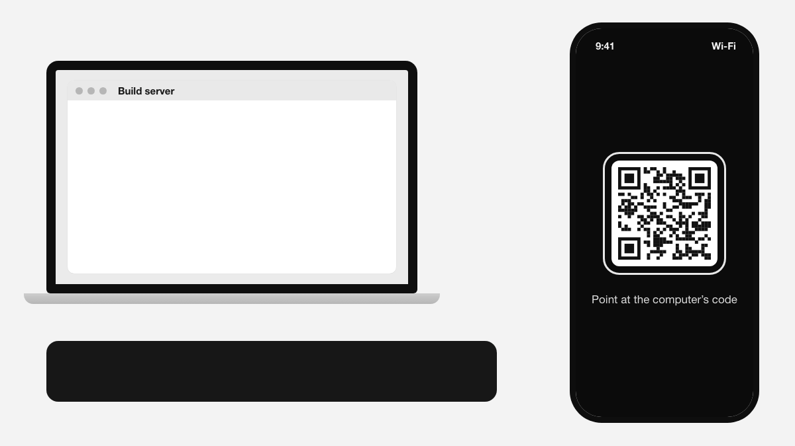
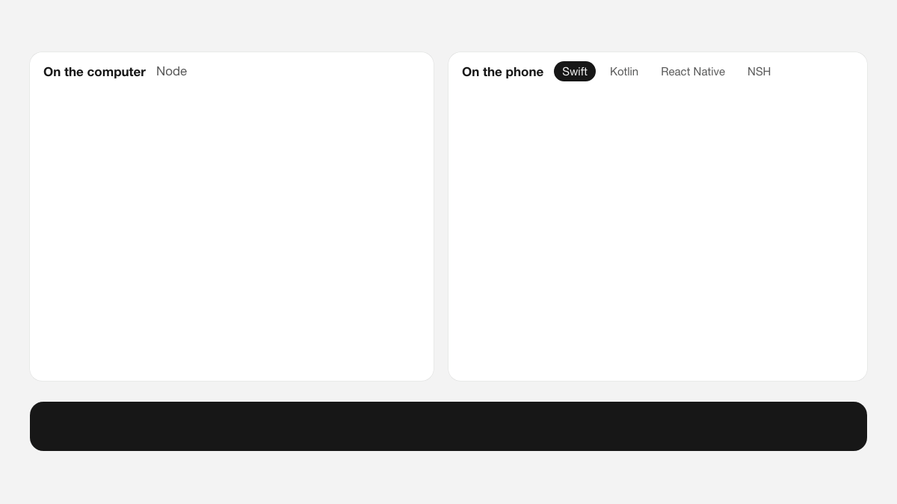

# TailPocket

Your app runs on your computer. You want your phone app to reach it at home, on the train, and on
hotel Wi-Fi. Normally that means running a server in the middle, setting up port forwarding, or
asking every user to install a VPN app and make an account.

With TailPocket the computer shows a QR code and the phone app scans it once. From then on the
phone app reaches a port on that computer from any network. There is no server to run, no
account, and nothing to install besides your own app.

<picture>
  <source media="(prefers-color-scheme: dark)" srcset="docs/images/what-it-is-dark.gif">
  
</picture>

## Give your agent the skill

Tell your coding agent:

> Make my app reachable from my phone. Use the TailPocket skill: https://github.com/jt-wang/tailpocket/blob/main/skills/tailpocket/SKILL.md

The skill has the agent ask you only what it cannot find in your code (your server's port, where
to keep the keys), add pairing to your computer app, and add a QR scanner to your phone app. It then pairs
a test phone, reopens the app, restarts the host, and revokes the phone, and reports which of
those steps it ran. A fresh agent given only the skill and a sample Node app passed all four.

To install it as a skill, copy `skills/tailpocket` into your agent's skills folder (for Claude
Code, `~/.claude/skills/`).

## What you get

Your app keeps its own protocol: the phone gets a `http://127.0.0.1:PORT` (or a raw stream) that
ends at the port you chose on the computer, so your existing HTTP, WebSocket or gRPC code works
unchanged. Under it, TailPocket picks among the routes you allow:

| Route | What it is | Encryption | Needs |
|---|---|---|---|
| `lan` | Direct TCP to the computer on the same Wi-Fi or Ethernet. On by default, private addresses only | Noise (end to end) | nothing |
| `tailcat` | A [Tailcat](https://github.com/tailscale/tailcat) node: WireGuard, peer to peer when the networks allow, through Tailcat's DERP relays otherwise | WireGuard | nothing (uses tailcat.dev) |
| `relay` | A [tailpocket-relay](cmd/tailpocket-relay/README.md) you run on a server you own | Noise (end to end; the relay sees ciphertext) | your relay |

- **Routes are interchangeable and Tailcat is optional.** Run any non-empty set: all three, LAN
  only, your relay only, LAN and relay, or Tailcat only. Without Tailcat nothing talks to tailcat.dev
  or a DERP server, on either side. The phone uses the best route that answers and moves to `lan`
  when it can, without cutting open connections.
- **Pairing with emoji.** The computer shows a QR code (or the phone finds it on the same Wi-Fi);
  both screens show the same four emoji and the person confirms on the computer. The code carries
  only the routes the computer runs, and the phone pins the computer's key from it.
- **Revoke** a phone on the computer: its open connections close and every route refuses it, with
  an encrypted message telling the phone to pair again.
- Your app can approve each connection (`authorize`) and get an audit log of pairings, revokes and
  refusals.

TailPocket is an independent open-source project built on Tailscale's Tailcat. Tailscale does not
make or support it.

### Choose the routes

The computer (Node; the same field is `routes` in the `tailpocket-host` helper and `Config.Routes` in Go):

```js
TailPocketHost.start({ forward, save })                               // default: Tailcat + LAN (+ relay if given)
TailPocketHost.start({ forward, save, routes: ['lan'] })              // LAN only, no Tailcat
TailPocketHost.start({ forward, save, routes: ['relay'],              // your own relay only, no Tailcat
  relays: [{ url: 'wss://relay.example.com', token: process.env.RELAY_TOKEN }] })
TailPocketHost.start({ forward, save, routes: ['lan', 'relay'], relays: [/* … */] })  // LAN + relay
TailPocketHost.start({ forward, save, tailcatOnly: true })            // Tailcat only, as in v0.2
```

The phone (optional; it uses only what the computer offers anyway):

```swift
try TailPocket.setRoutes(["lan", "relay"])   // Swift. Kotlin: TailPocket.default.setRoutes(listOf("lan", "relay"))
```
```ts
await tailPocket.setRoutes(["lan", "relay"]);  // NSH and React Native
await tailPocket.setRoutes(null);              // every route again; null must be explicit, setRoutes() is an error
```

An empty set, an unknown route, `relay` without `relays`, or `routes` together with `tailcatOnly`
is refused at start with the reason. Without Tailcat, open windows with `emoji: true` (the older
v1 codes pair over Tailcat). Run your relay with [cmd/tailpocket-relay](cmd/tailpocket-relay/README.md).

| Side | Stack | Package |
|---|---|---|
| Computer | Go | `connecthost` |
| Computer | Node, or any language that can spawn a process | `sdk/node`, or the `tailpocket-host` helper over stdin/stdout |
| Phone | Swift (iOS 15+, macOS 13+) | Swift package `TailPocket`, plus `TailPocketUI` (QR scanner, pairing view) |
| Phone | Kotlin (Android 8+) | `tailpocket`, plus `tailpocket-ui` (Compose QR scanner, pairing screen) |
| Phone | NSH | `sdk/js/nsh.ts`, plus the native adapters `TailPocketNSH` (iOS) and `tailpocket-nsh` (Android) |
| Phone | React Native | `sdk/react-native` |
| Phone | Go, or a command line | `connectphone`, `tailpocket-phone` |

Every phone SDK has the same calls: scan, pair, find nearby computers, connect, and a Keychain or
Keystore store for the phone key and the paired computers. It came out of two phone companion
apps that were each building this pairing by hand.

## Try it in two minutes

You need Node 20 or newer. Everything else comes ready-built from the release.

```sh
mkdir tailpocket-try && cd tailpocket-try
R=https://github.com/jt-wang/tailpocket/releases/download/v0.3.5
npm install $R/tailpocket-node.tgz
curl -fsSLO https://raw.githubusercontent.com/jt-wang/tailpocket/main/examples/node-host/server.mjs
node server.mjs                                    # prints "QR tailpocket1:…", a one-time pairing code
```

To try it with no Tailcat at all, over the local network only, start it as
`TAILPOCKET_ROUTES=lan TAILPOCKET_AUTO_APPROVE=1 node server.mjs` (it prints `QR2 tailpocket2:…`),
and pair below with `./phone pair -routes lan …`.

In a second terminal in the same folder, play the phone (on a Mac with Apple silicon; the release has
`tailpocket-phone` for Intel Macs, Linux and Windows too):

```sh
curl -fsSLo phone https://github.com/jt-wang/tailpocket/releases/download/v0.3.5/tailpocket-phone-darwin-arm64 && chmod +x phone
pbpaste | ./phone pair -key phone.key -out link.json -   # copy the tailpocket1:… text first
./phone connect -link link.json                         # prints "listening 127.0.0.1:PORT base BASE token …"
curl BASE/hello.txt                                     # BASE is http://127.0.0.1:PORT/_tailpocket/<token>; "hello from the computer"
```

For a real phone, run one of the examples below. To build TailPocket from source, see
[docs/BUILD.md](docs/BUILD.md).

## Add it by hand

<picture>
  <source media="(prefers-color-scheme: dark)" srcset="docs/images/how-to-use-dark.gif">
  
</picture>

Both animations are also pages with a pause button: [docs/illustrations](docs/illustrations).

**The computer side (Node):** start a host that forwards phones to your server, open a pairing
window, show its `qr` text as a QR code.

```js
import { TailPocketHost } from 'tailpocket';

const connectHost = await TailPocketHost.start({
  forward: '127.0.0.1:3000',                 // your server
  identity: saved?.identity, allowed: saved?.allowed,
  save: (state) => writeSecret(state),       // keys and paired phones; store it like a password
});
const pairing = await connectHost.pair({ ttl: 120, payload: sessionToken });
showQR(pairing.qr);
pairing.local({ service: '_myapp._tcp', confirm: (code, device) => askUser(code, device) }); // same Wi-Fi
const { device } = await pairing.paired;
```

Go apps use `connecthost.New(connecthost.Config{…})`, `h.Pair(ctx, connecthost.PairOptions{…})` and `p.ServeLocal`
directly. Any other language spawns `tailpocket-host` and talks to it in JSON lines
([docs/HOST-IPC.md](docs/HOST-IPC.md)).

**The phone side (Swift):**

```swift
let invite = try TailPocket.decodeInvite(scannedText)
let link = try await TailPocket.pair(invite, phoneKey: try store.phoneKey(), device: UIDevice.current.name)
try store.saveLink(link)
let connection = try TailPocket.connect(link)        // connection.baseURL → your server
```

**Kotlin:** the same names on `TailPocket.default` (`decodeInvite`, `pair`, `connect`), with
`TailPocketKeystoreStore`. Android blocks plain HTTP by default, so point your manifest at
`@xml/tailpocket_network_security_config`, which allows `127.0.0.1` only.

**NSH and React Native:** one TypeScript API over the native SDKs.

```ts
const link = await tailPocket.pair(await tailPocket.scan(), { device: "My phone", save: true });
const { baseUrl } = await tailPocket.connect();
const answer = await fetch(baseUrl + "/hello.txt");
```

The full examples are `examples/nsh-phone` (its native side is one line:
`TailPocketNsh.attach(view)`) and `examples/rn-phone`.

Per stack, [docs/INTEGRATE.md](docs/INTEGRATE.md) lists the files to add, the permissions to
declare, and the test that proves it works. The skill points the agent there too.

## What has been tested

Measured with an Apple-silicon Mac as the computer, over Tailcat's default relays:

- QR pairing, Go phone to Go host: the pairing window opened in 1.5 s; pairing took 4.7 s from
  the phone reading the code to paired; the first round trip through the tunnel came back 4.1 s
  after connecting. A restarted host keeps its address and its phones; a
  revoked phone is refused.
- Same-Wi-Fi pairing through real Bonjour.
- End to end against the Node example host: the Swift package on macOS, the iOS Simulator (Swift
  the NSH app and the React Native app), an Android emulator (Kotlin, the NSH app and the React
  Native app).
- Unit tests in every package (`go test ./...`, `swift test`, `./gradlew test`, `npm test` in
  `sdk/node`, `sdk/js` and `sdk/react-native`, `nsh test` in `examples/nsh-phone`).
- A physical Android phone: scanned the QR code and connected over cellular.

Not tested yet: physical iPhones, Linux and Windows hosts (the binaries build),
Android's Bonjour discovery (the emulator cannot see the Mac's Bonjour), pairing links on iOS (the
simulator asks before opening one, so the iOS test passes the invite as a launch argument), and the
built-in Go Bonjour responder on macOS (macOS's own `dns-sd` is used there).

## How it works, and what it trusts

1. The computer keeps a Noise key that phones pin, and runs the routes you chose: a listener on its
   private addresses (`lan`), a registration with your tailpocket-relay (`relay`), and a Tailcat
   node that admits only paired phones (`tailcat`).
2. Opening a pairing window makes a one-time code. The QR code carries it, the computer's public
   key and the routes. It expires with the window (default 2 minutes, at most 15).
3. The phone runs a Noise handshake over any route in the code, keyed with the one-time code and
   the pinned key. Both sides derive four emoji from the handshake; the computer's user confirms
   they match, so someone who saw the code cannot pair in the phone's place unnoticed.
4. From then on the phone connects with its own key over whichever route answers. `revoke` removes
   it: the computer closes its connections and tells it, encrypted, that it is no longer paired.

`lan` and `relay` are encrypted end to end with Noise (the relay sees only ciphertext); `tailcat` is
WireGuard through Tailcat's free, rate-limited relays (set `derpMapUrl` for your own). Phones paired
with v0.2 keep working over Tailcat.

Details: [docs/PROTOCOL.md](docs/PROTOCOL.md) (pairing and wire formats),
[docs/HOST-IPC.md](docs/HOST-IPC.md) (the helper's JSON lines),
[docs/BRIDGE.md](docs/BRIDGE.md) (the function table NSH and React Native call).

## License

MIT. The pairing design comes from Voxt Mobile; some portions are adapted from DSH Mobile (MIT).
See [NOTICE](NOTICE).
